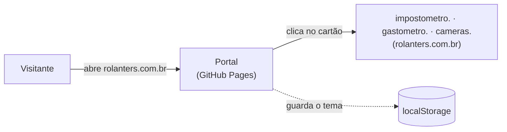

<div align="center">

# Portal Rolante

**Página de entrada dos projetos sobre Rolante/RS: um cartão por projeto, cada um levando ao seu subdomínio em `rolanters.com.br`.**


[](LICENSE)

</div>

---

## O que é

Uma página única que lista os projetos Rolante e leva o visitante ao site de cada um: Impostômetro, Gastômetro e
Câmeras. O portal não tem dado próprio, só links. Cada projeto mostra a sua fonte no seu próprio site.

Site independente, sem vínculo com a prefeitura.

> **Estado:** em desenvolvimento. Ainda não publicado em `rolanters.com.br`. Quando entrar no ar, adicione aqui o
> botão `Acessar o site` (como no [modelo](https://github.com/filipesfbr/identidade-rolante/blob/main/readmes/modelo/README.template.md)) e remova esta linha.

## O que tem

- **Cartões dos projetos:** símbolo, nome, descrição de uma linha e o domínio de destino. O cartão inteiro é o link.
- **Tema claro e escuro:** botão no canto superior direito (desktop). A escolha fica salva no navegador.
- **Mobile sempre escuro:** abaixo de 640 px o botão some e o tema é escuro, sem opção de mudar.

## Como funciona



1. O portal é HTML e CSS estáticos, servidos direto da branch `main`. Não há build, servidor nem banco.
2. Um script inline no `<head>` define o tema antes da primeira pintura (evita piscar). A ordem é: mobile força
   escuro, depois `localStorage['rolanters-theme']`, depois `prefers-color-scheme`.
3. Cada cartão é um `<a>` para `https://<subdomínio>.rolanters.com.br`, aberto na mesma aba.

| Arquivo | O quê |
|---|---|
| `index.html` | página, cartões e script do tema |
| `style.css` | tokens (claro e escuro) e layout |
| `assets/<projeto>/` | `mark.svg` e `mark-dark.svg` de cada projeto |
| `fonts/` | Inter variável (subconjunto latino, licença OFL) |

## Stack

| Camada | Tecnologia |
|---|---|
| Página | HTML + CSS puro, um script inline de tema |
| Fonte | Inter, hospedada no repo |
| Deploy | GitHub Pages pela branch `main` (raiz), domínio `rolanters.com.br` |

## Rodar local

```bash
npx serve .   # http://localhost:3000
```

Não há CI nem testes: o portal não tem lógica além do tema.

### Adicionar um projeto

1. Copie `mark.svg` e `mark-dark.svg` de `identidade-rolante/marca/<projeto>/assets/` para `assets/<projeto>/`.
2. Copie um bloco `<a class="cartao">` em `index.html` e troque projeto, nome, subdomínio e descrição.

## Limites conhecidos

- **A lista de projetos é escrita à mão** em `index.html`. São poucos cartões; um gerador não compensa.
- **O portal não confere se os subdomínios estão no ar.** Se um projeto cair, o cartão continua apontando para ele.
- **Sem símbolo nem imagem Open Graph próprios.** O ícone da aba é o emoji 🧉, e o link compartilhado aparece só com título e descrição. Foi decisão, não esquecimento.
- **No mobile o tema não muda.** É sempre escuro, por especificação do design.
- **A Inter é só o subconjunto latino.** Cobre o português; outro alfabeto cairia em `Helvetica Neue`.

## Identidade visual

Família Rolante: fonte Inter, fundo `#faf8f4`, tinta `#26221d` e um único acento, `#b4622f` (âmbar `#d98a52` no
tema escuro). Sem sombras nem gradientes, cartões com raio 14 e borda de 1 px. O portal não tem símbolo próprio (o ícone da aba é o emoji 🧉); os
símbolos exibidos são os dos projetos, em [`assets/`](assets/). Os tokens ficam em [`style.css`](style.css); a
especificação e os arquivos da marca estão em
[`identidade-rolante`](https://github.com/filipesfbr/identidade-rolante).

## Licença e créditos

Licença **MIT**, veja [`LICENSE`](LICENSE). O portal só aponta para os projetos; os dados e os créditos de cada um
estão no site e no README do próprio projeto. Independente, sem vínculo com a prefeitura.
